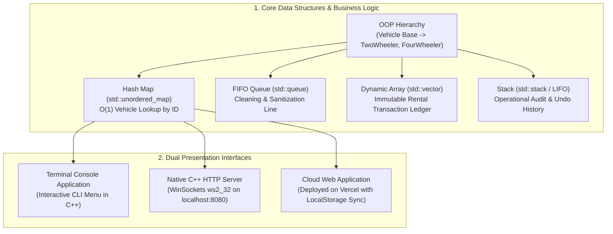
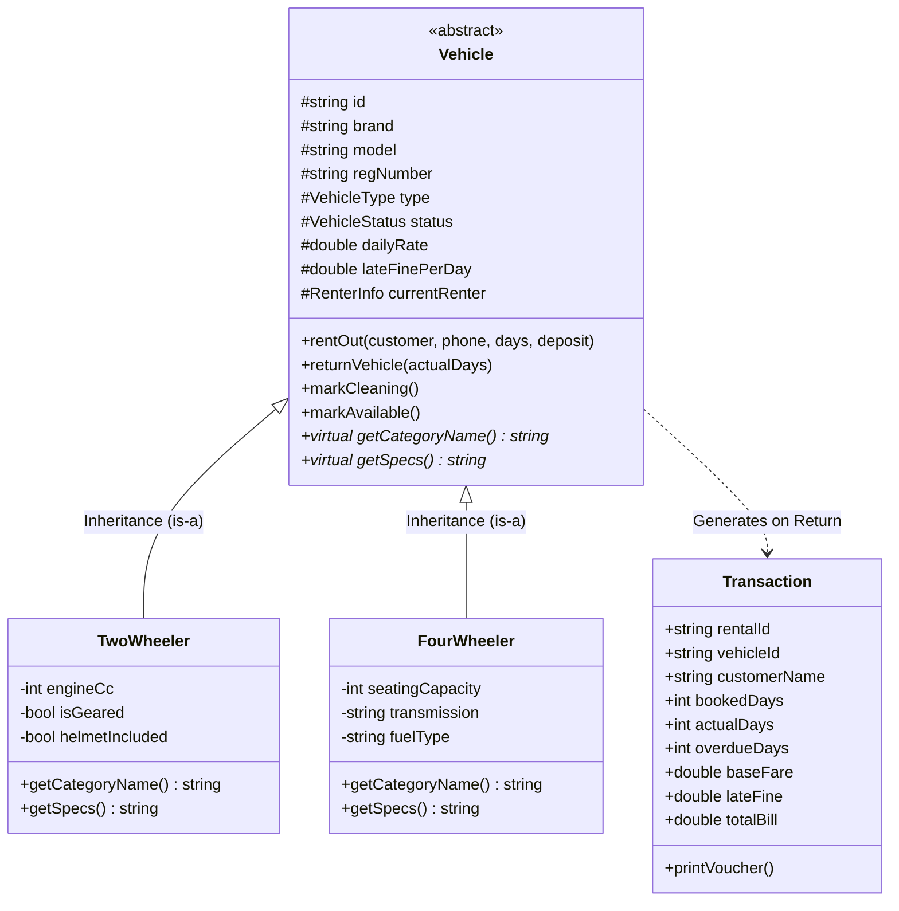
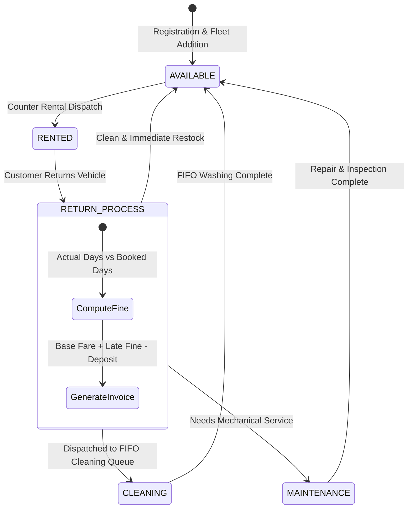

# 🚗 Wheels & Ways — Project Blueprint & Presentation Guide

> **Project Title:** Wheels & Ways — Professional Vehicle Rental & Fleet Management System  
> **Target Platform:** Dual Architecture (Terminal C++14 Engine + Localhost C++ HTTP Server + Cloud-Deployed Web Application)  
> **Core Concepts:** Object-Oriented Programming (OOP), Data Structures & Algorithms, Network Sockets, Cloud Deployment  

---

## 📑 Executive Summary

**Wheels & Ways** is an enterprise-grade vehicle rental management system designed for realistic vehicle rental operations in India. It manages two primary categories (**2-Wheelers** and **4-Wheelers**) with full lifecycle tracking: **Available**, **Rented**, **In Cleaning (FIFO Queue)**, and **Under Maintenance**.

The system implements accurate daily rate calculation, an automated overdue fine engine, security deposit reconciliation, and a printable settlement invoice.

---

## 🏛️ System Architecture: The Dual-Core Paradigm

The project is engineered with a **hybrid architecture** that can be presented from two complementary perspectives:

---

## 🧠 Data Structures & Algorithmic Complexity

| Data Structure | C++ STL Container | Practical Role in System | Time Complexity | Justification |
| :--- | :--- | :--- | :--- | :--- |
| **Hash Map** | `std::unordered_map<string, Vehicle*>` | Vehicle Registry by ID (`TW101`, `FW201`) | **$O(1)$ Average** Search/Update | Fast dispatch and lookup during customer counter checkout. |
| **FIFO Queue** | `std::queue<string>` | Cleaning & Service Bay Pipeline | **$O(1)$ Enqueue / Dequeue** | First vehicle returned is the first vehicle washed (Fair First-In, First-Out operational policy). |
| **Dynamic Array** | `std::vector<Transaction>` | Historical Transaction & Invoice Ledger | **$O(1)$ Amortized Append** | Append-only financial audit trail for computing revenue and late fines. |
| **Stack (LIFO)** | `std::stack<OperationLog>` | Undo / Recent Operational Activity Log | **$O(1)$ Push / Pop** | Allows rolling back the most recent staff dispatch or viewing the immediate audit trail. |

---

## 🧬 Object-Oriented Programming (OOP) Class Hierarchy

---

## 🔄 Vehicle Lifecycle & State Machine

Every vehicle in the fleet follows a strict state transition model:

> [!IMPORTANT]
> **Key Business Rule:** When a vehicle is returned, it does **not** become available automatically if cleaning or maintenance is needed. It must be serviced through the FIFO queue first.

---

## 📐 Mathematical & Billing Engine

### 1. Upfront Rental Booking Estimation
$$\text{Base Fare} = \text{Booked Days} \times \text{Daily Rental Rate}$$
$$\text{Estimated Advance Payable} = \text{Base Fare} + \text{Security Deposit}$$

### 2. Overdue Days Calculation
$$\text{Overdue Days} = \max(0, \text{Actual Days Used} - \text{Booked Duration})$$

### 3. Late Return Fine Calculation
$$\text{Late Fine} = \text{Overdue Days} \times \text{Vehicle Late Fine Rate per Day}$$
*(If the vehicle is returned on time or early, $\text{Overdue Days} = 0 \implies \text{Late Fine} = \text{₹0.00}$).*

### 4. Final Settlement Equation
$$\text{Gross Total} = \text{Base Fare} + \text{Late Fine} + \text{Damage / Additional Charges}$$
$$\text{Net Settlement Balance} = \text{Gross Total} - \text{Security Deposit Received}$$
- If $\text{Net Settlement Balance} \ge 0$: Amount **payable by customer**.
- If $\text{Net Settlement Balance} < 0$: Amount **refunded to customer**.

---

## 🛠️ Step-by-Step Engineering Walkthrough

### Phase 1: Core Domain Modeling (C++)
- Created `Vehicle.h`, `TwoWheeler.h`, `FourWheeler.h` declaring encapsulation and polymorphism.
- Built `Transaction.h` to hold billing records and printable invoice formats.

### Phase 2: Terminal Console Driver
- Implemented `RentalSystem.cpp` holding the `unordered_map`, `queue`, and `vector`.
- Crafted `main.cpp` with interactive input sanitation (`std::cin.clear()`, buffer flush).

### Phase 3: Native Web Server via WinSock2
- Implemented `src/web_server.cpp` using the native Windows Sockets library (`ws2_32`).
- Wrote an HTTP request parser capable of handling `GET` and `POST` payloads with `Content-Length` framing.
- Exposed RESTful endpoints: `/api/vehicles`, `/api/rent`, `/api/return`, `/api/cleaning-bay`, `/api/stats`.

### Phase 4: Professional Enterprise UI/UX Design
- Built a table-first fleet management dashboard adhering to Indian vehicle standards (`DL 01 AB 1234`, `HR 26 BC 5678`).
- Integrated Indian Rupee formatting (**₹**), clean status pills, and printable vouchers.

### Phase 5: Cloud Deployment & CI/CD
- Engineered a hybrid client-side engine with `localStorage` so the site runs self-contained on **Vercel**.
- Configured `vercel.json` with clean routing rewrites.
- Pushed to GitHub with automatic Vercel webhook deployment.

---

## 🎤 Slide-by-Slide Presentation Blueprint

Use this 10-slide outline for your presentation deck:

### Slide 1: Title & Introduction
- **Headline:** Wheels & Ways — Vehicle Rental & Fleet Management System
- **Presenter:** Mansi Sharma
- **Core Pitch:** "A dual-paradigm rental operations software built with C++ data structures and modern web interfaces, handling fleet inventory, rate calculation, late return fines, and FIFO service queuing."

### Slide 2: Problem Statement & Motivation
- **The Challenge:** Small vehicle rental businesses struggle with manual logbooks, inaccurate late fine calculations, and untracked vehicle washing queues.
- **The Solution:** A unified system with automated rate engines, instant receipt generation, and real-time fleet availability tracking.

### Slide 3: System Architecture
- Show the **Dual-Core Architecture Diagram** (C++ Core + WinSock Server + Cloud Web UI).
- Emphasize that the web interface directly reflects the backend algorithmic models.

### Slide 4: Data Structures & Complexity (The Technical Core)
- Highlight the 3 core data structures:
  1. **Hash Map:** $O(1)$ fast ID lookup.
  2. **FIFO Queue:** Ordered cleaning line.
  3. **Vector / Ledger:** Immutable audit trail of completed bookings.
- Explain why each structure was selected based on time complexity.

### Slide 5: OOP Design & Indian Fleet Modeling
- Explain the inheritance hierarchy: `Vehicle` (Base) $\rightarrow$ `TwoWheeler` & `FourWheeler`.
- Show realistic Indian vehicles: Honda Activa, Royal Enfield Classic 350, Maruti Swift Dzire, Mahindra Thar.

### Slide 6: The Operational Workflow (Rent $\rightarrow$ Return $\rightarrow$ Service)
- Walk through the three-step lifecycle:
  1. **Counter Dispatch:** Rented out with security deposit.
  2. **Return & Settlement:** Auto-calculated overdue fines.
  3. **Cleaning Bay:** Dispatched to FIFO queue before returning to stock.

### Slide 7: Mathematical Formulas & Billing Engine
- Display the formulas for:
  - $\text{Overdue Days} = \max(0, \text{Actual} - \text{Booked})$
  - $\text{Late Fine} = \text{Overdue Days} \times \text{Fine Rate}$
  - Net settlement against security deposit.

### Slide 8: Live Product Demonstration
- Switch to the live Vercel web application or localhost:
  - Demo 1: Filter fleet by 2-Wheelers and 4-Wheelers.
  - Demo 2: Rent an Available vehicle.
  - Demo 3: Return a vehicle with 2 overdue days $\rightarrow$ show fine applied on receipt.
  - Demo 4: View the FIFO Cleaning Bay and service the next vehicle.

### Slide 9: Deployment & DevOps
- Show the Git $\rightarrow$ GitHub $\rightarrow$ Vercel continuous deployment pipeline.
- Mention `push_to_github.bat` and `vercel.json` URL rewrites.

### Slide 10: Conclusion & Future Scope
- **Key Takeaways:** Fully working enterprise workflow, zero-bloat UI, strict data structure compliance.
- **Future Enhancements:** GPS fleet telemetry, Aadhaar/DL verification API, online UPI payment gateway.

---

## 🎯 Master Viva / Q&A Preparation

| Question | Strong Technical Answer |
| :--- | :--- |
| **Q1: Why did you use a Queue for the cleaning bay instead of a simple array?** | "A Queue naturally enforces the **First-In, First-Out (FIFO)** operational policy. In a rental office, the vehicle returned earliest must be washed first so it can return to available stock sooner. Enqueue and Dequeue operations are both $O(1)$, which is optimal." |
| **Q2: How does your system prevent double rentals?** | "Before processing a rental dispatch, the system checks the vehicle's `status` property. If status is `RENTED`, `CLEANING`, or `MAINTENANCE`, the operation is aborted with a validation error. Only `AVAILABLE` status vehicles can be dispatched." |
| **Q3: What happens if a customer returns a vehicle earlier than expected?** | "The overdue formula uses $\max(0, \text{Actual} - \text{Booked})$. If actual days are less than booked days, the result is zero, ensuring no fine is charged. The base fare is calculated based on the contract terms." |
| **Q4: How does the C++ backend connect to the web interface?** | "We wrote a native HTTP Web Server in C++ using Windows Sockets (`ws2_32`). It binds to port 8080, listens for HTTP requests, and returns JSON formatted responses directly from our C++ classes." |
| **Q5: What is the time complexity of searching a vehicle by ID?** | "Because we index vehicles in a Hash Map (`std::unordered_map`), the average time complexity is **$O(1)$**, providing instantaneous lookups regardless of fleet size." |
